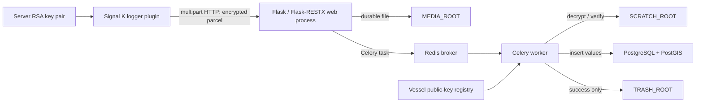

# Architecture

## Purpose and scope

DYNAMO Signal K Storage Server is the shore-side receiver for encrypted Signal
K telemetry parcels produced by the companion `dynamo-signalk-logger-plugin`.
It accepts a parcel over HTTP, verifies that the registered vessel signed its
contents, decrypts and decompresses it asynchronously, and stores the Signal K
delta values in PostgreSQL/PostGIS. The system is deliberately an ingestion
service: it is not an identity-registration service, a query API, or a
dashboard.

## Components and responsibilities

| Component | Implementation | Persistent state | Primary responsibility |
| --- | --- | --- | --- |
| HTTP receiver | Flask, Flask-RESTX | `MEDIA_ROOT` | Validate upload metadata, atomically allocate a parcel file, and enqueue work. |
| Work queue | Celery with Redis broker/result backend | Redis | Decouple request latency from cryptography and database work. |
| Parcel worker | `app.tasks.process_file_task` | `SCRATCH_ROOT`, `TRASH_ROOT` | Recover the content key, verify authenticity, and archive only successful parcels. |
| Relational store | SQLAlchemy with PostgreSQL/PostGIS | database volume | Persist individual Signal K values and spatial positions. |
| Key material | PyCryptodome RSA keys | `data/keys` | Hold the server private key and a public-key registry for vessels. |

## Ingestion sequence

1. The plugin sends `POST /upload/vessels.<selfId>` as `multipart/form-data`.
   The required fields are `sessionId` and `file`; the file MIME type must be
   `application/octet-stream`.
2. The receiver accepts identifiers matching `[A-Za-z0-9][A-Za-z0-9._:-]*` and
   writes a uniquely named `.log.gz.enc` file beneath
   `MEDIA_ROOT/vessels.<selfId>/`. It then enqueues the basename and returns
   HTTP 200. A 200 response means *accepted for processing*, not that database
   storage has completed.
3. A worker reads the first line as a Base64 OAEP-wrapped 32-byte secret. The
   remaining bytes are an encrypted payload.
4. The worker decrypts with the server private key, derives the AES-256 key as
   SHA-256(secret), decrypts AES-CBC, removes validated PKCS#7 padding, and
   gunzips the plaintext.
5. The first plaintext line is a JSON signature header. The remaining bytes
   are newline-delimited Signal K delta JSON. RSA-SHA256 verification uses the
   registered vessel key named `PUBLIC_KEY_ROOT/<selfId>-public.pem`.
6. Each update/value is stored. On success the original parcel is moved to
   `TRASH_ROOT/<selfId>/`; any exception leaves it in `MEDIA_ROOT` for retry.

The current receiver supports the companion plugin’s canonical layout
`wrapped-key + newline + ciphertext + IV`, where IV is the final 16 bytes. It
also attempts the historical leading-IV interpretation for recovery of parcels
created by earlier receivers.

## Storage model

The server creates tables dynamically from Signal K paths: dots become
underscores (for example, `navigation.speedOverGround` becomes
`navigation_speedOverGround`). Each table has `(context, timestamp, source)`
as a composite primary key and a `value` column. `navigation.position` adds
longitude, latitude, and a PostGIS point. A `sources` table records source
descriptors by `(context, label)`.

This schema makes path-local queries simple, but it is not a general event
store: a duplicate primary key is treated as an insert failure, and changing a
value’s type for an existing path may require a migration. Operational users
should provision PostgreSQL/PostGIS rather than SQLite, because the position
table uses `Geometry(POINT)`.

## Delivery and recovery semantics

The protocol provides at-least-once *processing attempts*, not exactly-once
end-to-end delivery. The client retains a parcel until a 2xx response, while
the server writes it before queueing it. A worker failure retains the server
copy. Duplicate client deliveries or a retry after a database commit can
therefore encounter the composite primary key. Treat these as an operational
deduplication concern and monitor worker logs and the media directory.

On application startup, `create_app()` scans every vessel subdirectory of
`MEDIA_ROOT` and re-enqueues each file. Consequently, `MEDIA_ROOT`, the key
directories, and database storage must be persistent across restarts.
